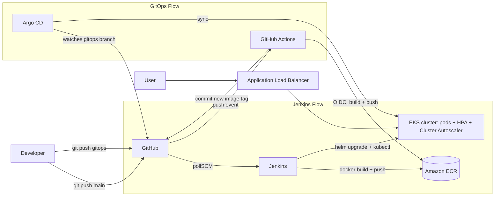

# DevOps Tech Challenge 2 — Hello World on AWS EKS

A Node.js/Express "Hello, World!" app, containerized with Docker, deployed to an autoscaling AWS EKS cluster provisioned with Terraform, and delivered through two CI/CD approaches:

| Branch | CI/CD approach | Deploys to namespace |
|---|---|---|
| `main` | **Jenkins** pipeline: build → push to ECR → deploy with Helm + kubectl | `default` |
| `gitops` | **GitHub Actions** (CI) + **Argo CD** (CD) | `gitops` |

## Live URLs

- **Jenkins deployment (main):** http://k8s-default-helloapp-dfcca4182e-1004450607.us-east-1.elb.amazonaws.com
- **GitOps deployment (gitops):** http://k8s-gitops-helloapp-006a690737-1288132214.us-east-1.elb.amazonaws.com

---

## Architecture



**Request path:** Browser → ALB (public subnets) → Kubernetes Ingress → Service → Pods (port 3000) on worker nodes in private subnets.

---

## Repository Structure

```
.
├── app/                     # Node.js/Express app + Dockerfile
├── app-chart/               # Helm chart (Deployment, Service, Ingress, HPA)
├── terraform/               # VPC, EKS cluster, node group, IAM, security groups
├── jenkins/Dockerfile       # Custom Jenkins image with docker, aws, kubectl, helm
├── Jenkinsfile              # Jenkins CI/CD pipeline (main branch)
├── .github/workflows/ci.yml # GitHub Actions CI (gitops branch)
└── argocd/application.yaml  # Argo CD Application (gitops branch)
```

---

## Requirements Coverage

| Requirement | Implementation |
|---|---|
| Hello World web app | Node.js/Express on port 3000 (`app/`) |
| Dockerized | `app/Dockerfile`, built for `linux/amd64` |
| EKS via Terraform | `terraform/` provisions VPC, EKS, managed node group |
| 4 nodes total, 1 always active, t3.small | Node group `min_size = 1`, `desired_size = 1`, `max_size = 4`, `instance_types = ["t3.small"]` |
| Node autoscaling | Cluster Autoscaler (IRSA) scales the node group when pods are Pending |
| 1 pod per node, up to 3 per node | Pod anti-affinity spreads pods across nodes; 400m CPU requests limit a t3.small to ~3 app pods |
| HPA at 50% CPU or memory, max 3 pods/node | HPA `minReplicas: 1`, `maxReplicas: 12` (3 × 4 nodes), 50% CPU and 50% memory targets |
| ALB | AWS Load Balancer Controller provisions an internet-facing ALB from the Ingress |
| Jenkins: build, push to ECR, deploy with kubectl & Helm | `Jenkinsfile` |
| GitOps alternative | `gitops` branch: GitHub Actions + Argo CD |

---

## Prerequisites

- AWS account and an IAM user/role with permissions for EKS, EC2, IAM, ECR, and ELB
- Tools installed locally: `aws` CLI v2, `terraform`, `kubectl`, `helm`, `eksctl`, `docker`, `git`
- AWS credentials configured (`aws configure`)
- An ECR repository named `devops-challenge2-app` in `us-east-1`

---

## 1. Provision the Infrastructure (Terraform)

```bash
cd terraform
terraform init
terraform plan
terraform apply
aws eks update-kubeconfig --region us-east-1 --name devops-challenge2-cluster
kubectl get nodes
```

### Terraform Code Explained

| File | Purpose |
|---|---|
| `provider.tf` | AWS provider configuration and region |
| `variables.tf` | Input variables (project name, region, CIDRs, etc.) |
| `vpc.tf` | VPC with public and private subnets across two AZs. Public subnets are tagged `kubernetes.io/role/elb = 1` so the ALB controller can place load balancers there |
| `security-groups.tf` | Security groups for the cluster control plane and worker nodes |
| `iam.tf` | IAM roles for the EKS control plane and worker nodes, including the worker node, CNI, and ECR read-only policies |
| `eks-cluster.tf` | The EKS cluster (Kubernetes 1.31) |
| `node-group.tf` | Managed node group: `t3.small`, min 1 / desired 1 / max 4, running in private subnets |
| `outputs.tf` | Useful outputs such as the cluster name and endpoint |

> **Design note:** Worker nodes run in private subnets and are never directly exposed. Only the ALB sits in the public subnets.

---

## 2. Install Cluster Add-ons

These were installed once after the cluster came up.

### IAM OIDC provider (required for IRSA)
```bash
eksctl utils associate-iam-oidc-provider --cluster devops-challenge2-cluster --region us-east-1 --approve
```

### AWS Load Balancer Controller
```bash
curl -o iam_policy.json https://raw.githubusercontent.com/kubernetes-sigs/aws-load-balancer-controller/main/docs/install/iam_policy.json
aws iam create-policy --policy-name AWSLoadBalancerControllerIAMPolicy --policy-document file://iam_policy.json

eksctl create iamserviceaccount \
  --cluster devops-challenge2-cluster --region us-east-1 \
  --namespace kube-system --name aws-load-balancer-controller \
  --attach-policy-arn arn:aws:iam::<ACCOUNT_ID>:policy/AWSLoadBalancerControllerIAMPolicy \
  --approve

helm repo add eks https://aws.github.io/eks-charts && helm repo update
helm install aws-load-balancer-controller eks/aws-load-balancer-controller -n kube-system \
  --set clusterName=devops-challenge2-cluster \
  --set serviceAccount.create=false \
  --set serviceAccount.name=aws-load-balancer-controller \
  --set region=us-east-1 \
  --set vpcId=<VPC_ID>
```

### metrics-server (required for HPA)
```bash
helm repo add metrics-server https://kubernetes-sigs.github.io/metrics-server/
helm install metrics-server metrics-server/metrics-server -n kube-system
```

### Cluster Autoscaler
An IAM policy (`ClusterAutoscalerPolicy`) allows describing Auto Scaling groups and resizing **only** groups tagged `k8s.io/cluster-autoscaler/devops-challenge2-cluster = owned`.

```bash
eksctl create iamserviceaccount \
  --cluster devops-challenge2-cluster --region us-east-1 \
  --namespace kube-system --name cluster-autoscaler \
  --attach-policy-arn arn:aws:iam::<ACCOUNT_ID>:policy/ClusterAutoscalerPolicy \
  --approve

helm repo add autoscaler https://kubernetes.github.io/autoscaler
helm install cluster-autoscaler autoscaler/cluster-autoscaler -n kube-system \
  --set autoDiscovery.clusterName=devops-challenge2-cluster \
  --set awsRegion=us-east-1 \
  --set rbac.serviceAccount.create=false \
  --set rbac.serviceAccount.name=cluster-autoscaler \
  --set image.tag=v1.31.0
```

---

## 3. Helm Chart Highlights (`app-chart/values.yaml`)

```yaml
resources:
  requests: { cpu: 400m, memory: 128Mi }
  limits:   { cpu: 500m, memory: 256Mi }

autoscaling:
  enabled: true
  minReplicas: 1
  maxReplicas: 12
  targetCPUUtilizationPercentage: 50
  targetMemoryUtilizationPercentage: 50

ingress:
  enabled: true
  className: alb
  annotations:
    alb.ingress.kubernetes.io/scheme: internet-facing
    alb.ingress.kubernetes.io/target-type: ip
```

Pods use **preferred pod anti-affinity** on `kubernetes.io/hostname`, so the scheduler spreads replicas across nodes first and stacks them only when needed.

### How autoscaling works end to end
1. Load increases and CPU passes 50% of the requested 400m.
2. The **HPA** adds replicas.
3. When a node has no room left (about 3 app pods per t3.small), new pods go **Pending**.
4. The **Cluster Autoscaler** sees the Pending pods and grows the node group, up to 4 nodes.
5. When load drops, pods scale in after about 5 minutes and extra nodes after about 10.

---

## 4. Jenkins CI/CD (main branch)

### Run Jenkins locally in Docker
The custom image (`jenkins/Dockerfile`) adds the Docker CLI + buildx, AWS CLI v2, kubectl 1.31, and Helm 3.

```bash
docker build -t jenkins-devops jenkins/
docker run -d --name jenkins \
  -p 8080:8080 -p 50000:50000 \
  -v jenkins_home:/var/jenkins_home \
  -v /var/run/docker.sock:/var/run/docker.sock \
  -v ~/.aws:/root/.aws:ro \
  jenkins-devops
docker exec jenkins cat /var/jenkins_home/secrets/initialAdminPassword
```

Open http://localhost:8080, install the suggested plugins, then:
1. Add a **Username with password** credential (ID `github-pat`) using a GitHub fine-grained token with **Contents: Read-only**.
2. Create a **Pipeline** job using *Pipeline script from SCM* → Git → this repo → branch `*/main` → script path `Jenkinsfile`.

### Pipeline Explained (`Jenkinsfile`)

| Stage | What it does |
|---|---|
| **Trigger** | `pollSCM('H/5 * * * *')` checks GitHub every 5 minutes, so every push to `main` deploys automatically |
| **Checkout** | Pulls the repo |
| **Build Image** | `docker build --platform linux/amd64`, tagged with the Jenkins build number and `latest`. EKS nodes are x86_64, so the image is built for amd64 even on an ARM Mac |
| **Push to ECR** | Logs in with a short-lived ECR token and pushes both tags |
| **Deploy to EKS** | `helm upgrade --install` with the new image tag, then `kubectl rollout status` to confirm the new pods are healthy |
| **Verify** | Prints pods, HPA, and ingress into the build log |
| **Post** | Always logs out of ECR |

Tagging with the build number makes every deployment traceable and easy to roll back (`helm rollback hello-app <revision>`).

> **Local-setup tradeoffs:** Jenkins runs as root so it can use the host Docker socket, and it reads AWS credentials from a read-only mount of `~/.aws`. In production, you would run Jenkins on dedicated infrastructure, use an IAM role instead of mounted credentials, and use GitHub webhooks instead of polling.

---

## 5. GitOps CI/CD (gitops branch)

### Flow
1. A push to `gitops` that changes `app/**` triggers **GitHub Actions**.
2. Actions authenticates to AWS with **OIDC** (no stored AWS keys), builds the image for amd64, and pushes it to ECR tagged with the commit SHA.
3. Actions commits the new tag into `app-chart/values.yaml` on the `gitops` branch.
4. **Argo CD** watches `app-chart/` on the `gitops` branch and automatically syncs the change to the cluster.

The CI pipeline never touches the cluster. Git is the single source of truth.

### AWS access for GitHub Actions
- An IAM OIDC provider for `token.actions.githubusercontent.com`
- An IAM role, `github-actions-ecr-push`, that:
  - trusts only this repository's `gitops` branch
  - can push only to the `devops-challenge2-app` ECR repository

> **Note:** GitHub's OIDC `sub` claim includes immutable owner and repository IDs (for example `repo:owner@<id>/repo@<id>:ref:refs/heads/gitops`). The IAM trust policy must match this exact format.

### Argo CD setup
```bash
kubectl create namespace argocd
kubectl apply -n argocd --server-side --force-conflicts \
  -f https://raw.githubusercontent.com/argoproj/argo-cd/stable/manifests/install.yaml

kubectl port-forward svc/argocd-server -n argocd 8081:443
kubectl -n argocd get secret argocd-initial-admin-secret -o jsonpath="{.data.password}" | base64 -d; echo
```

In the Argo CD UI (https://localhost:8081), connect this private repo under **Settings → Repositories** using a GitHub token with **Contents: Read-only**. Then apply the Application:

```bash
kubectl apply -f argocd/application.yaml
```

`argocd/application.yaml` uses automated sync with `prune` and `selfHeal`, so manual changes in the cluster are reverted to match Git. It deploys into its own `gitops` namespace so it never conflicts with the Jenkins-managed release in `default`.

---

## 6. Test Autoscaling

```bash
kubectl run load-gen --image=busybox --restart=Never -- /bin/sh -c \
  "for i in 1 2 3 4 5 6 7 8; do (while true; do wget -q -O- http://hello-app-app-chart:3000 >/dev/null 2>&1; done) & done; wait"

kubectl get hpa
kubectl get pods -o wide
kubectl get nodes

kubectl delete pod load-gen   # stop the test
```

---

## 7. Teardown

Delete Kubernetes-created AWS resources **before** running `terraform destroy`. ALBs created by the Load Balancer Controller are not managed by Terraform, and leftover ALBs or their security groups will block the VPC from being deleted.

```bash
# 1. Remove the apps (this deletes their ALBs)
kubectl delete -f argocd/application.yaml
helm uninstall hello-app
kubectl delete namespace gitops

# 2. Confirm both ALBs are gone (wait until this returns nothing)
aws elbv2 describe-load-balancers --query "LoadBalancers[?contains(LoadBalancerName,'k8s-')].LoadBalancerName"

# 3. Remove add-ons and IRSA roles
helm uninstall aws-load-balancer-controller -n kube-system
helm uninstall cluster-autoscaler -n kube-system
kubectl delete namespace argocd
eksctl delete iamserviceaccount --cluster devops-challenge2-cluster --region us-east-1 --namespace kube-system --name aws-load-balancer-controller
eksctl delete iamserviceaccount --cluster devops-challenge2-cluster --region us-east-1 --namespace kube-system --name cluster-autoscaler

# 4. Destroy the infrastructure
cd terraform && terraform destroy

# 5. Clean up manually created IAM resources
aws iam delete-policy --policy-arn arn:aws:iam::<ACCOUNT_ID>:policy/AWSLoadBalancerControllerIAMPolicy
aws iam delete-policy --policy-arn arn:aws:iam::<ACCOUNT_ID>:policy/ClusterAutoscalerPolicy
aws iam delete-role-policy --role-name github-actions-ecr-push --policy-name ecr-push
aws iam delete-role --role-name github-actions-ecr-push
aws iam list-open-id-connect-providers   # delete the EKS and GitHub providers if no longer needed

# 6. Stop local Jenkins
docker rm -f jenkins
```

---

## Troubleshooting Notes (Issues Hit While Building)

| Problem | Cause | Fix |
|---|---|---|
| No IAM OIDC provider for the cluster | The cluster had an OIDC issuer, but it was not registered with IAM | `eksctl utils associate-iam-oidc-provider` |
| HPA targets showed `<unknown>` | Pods had no CPU/memory requests, so utilization could not be calculated | Added `resources.requests` to the chart |
| Helm failed with a YAML parse error | `resources: {}` still had its braces while nested keys were added below it | Removed the `{}` |
| GitHub Actions `Not authorized to perform sts:AssumeRoleWithWebIdentity` | GitHub's OIDC `sub` claim includes immutable owner/repo IDs, which did not match the trust policy | Decoded the token claims in the workflow and updated the trust policy to the exact `sub` value |
| `git push` rejected on `gitops` | The CI bot had committed a new image tag | `git pull --rebase` before pushing |
